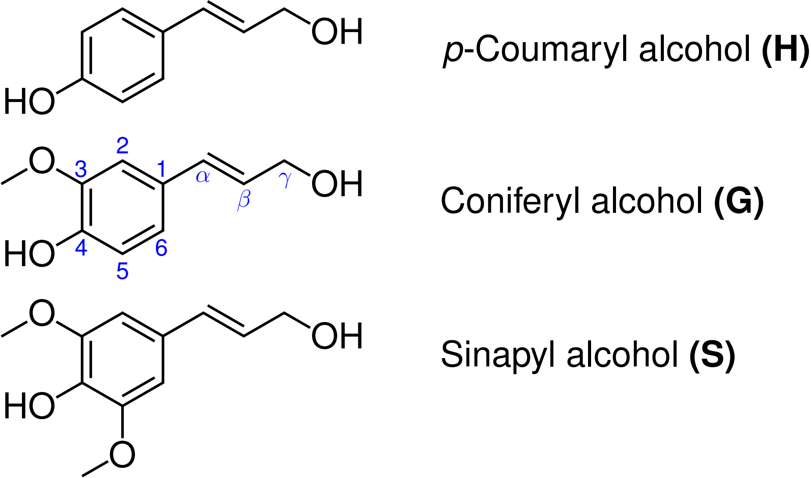

Lignin Builder
==============

.. note::

   Builders in MakroLyzer require RDKit. Activate your MakroLyzer environment and install MakroLyzer with its builder
   dependencies using ``python -m pip install ".[builder]"`` from the
   ``polymer_analysis`` directory. For more details see the :doc:`Installation details </01_Installation>`.

Lignins are complex organic polymers that form the main structural components of the supportive tissues of most plants. 
They are important in the formation of cell walls in wood, as they provide rigidity and are resistant to decay. 
Chemically, lignins are polymers formed by the cross-linking of phenolic precursors also called monolignols. 
The three **monolignols** are shown in the image below. 

These monolignols are connected via different linkers. Common linkers are:

* ``beta-O-4``
* ``beta-5``
* ``beta-beta``
* ``5-5`` / ``4-O-beta``
* ``5-O-4``
* ``beta-1``

.. note::

   Currently available linkers are: ``4-O-beta`` 

Linker names use the following convention:

* **First position** = incoming monolignol (usually β)
* **Second position** = existing lignin chain (usually O-4 or C5)

In MakroLyzer, the user specifies a monolignol sequence and a corresponding linker sequence.
The builder constructs the lignin strand by adding monolignols sequentially from left to right, connecting each new monolignol via the specified linker.
After each addition, the structure is optimized using the Universal Force Field (UFF) [1]_ implemented in RDKit [2]_.

Command Line Input
------------------
.. line-block::
  ``-buildLignin``
  ``--buildLigninFile``
  ``--lignin``
      Build a lignin strand from a JSON recipe specifying the monolignol and linker sequences.
      No structure or trajectory input file is required for a builder-only run.

  ``--lignin-file``
      Output XYZ filename for the constructed lignin strand.
      *Default: lignin.xyz*

  ``--builder-max-iterations``
      Maximum number of UFF optimization iterations after each monomer connection.
      Must be a positive integer.
      *Default: 1500*

Example
^^^^^^^

Create a file named ``recipe.json`` with the following contents:

.. code-block:: json

   {
     "monomer": ["G", "H", "S"],
     "linker": ["4-O-beta", "4-O-beta"]
   }

The monolignols are specified as ``H``, ``G``, or ``S``.
The linker sequence must contain exactly one fewer entry than the monolignol sequence.
Currently, only the ``4-O-beta`` linkage is implemented.

Build the strand with the default settings, or specify an output filename and optimization iteration limit:

.. code-block:: bash

   MakroLyzer -buildLignin recipe.json
   MakroLyzer -buildLignin recipe.json --lignin-file myLignin.xyz --builder-max-iterations 3000

.. [1]  Rappé, A. K.; Casewit, C. J.; Colwell, K. S.; Goddard, W. A., III; Skiff, W. M. UFF, a full periodic table force field for molecular mechanics and molecular dynamics simulations J. Am. Chem. Soc. 1992, 114, 10024-10035.
       DOI: 10.1021/ja00051a040
.. [2]  RDKit: Open-source cheminformatics. https://www.rdkit.org
       DOI: 10.5281/zenodo.591637
