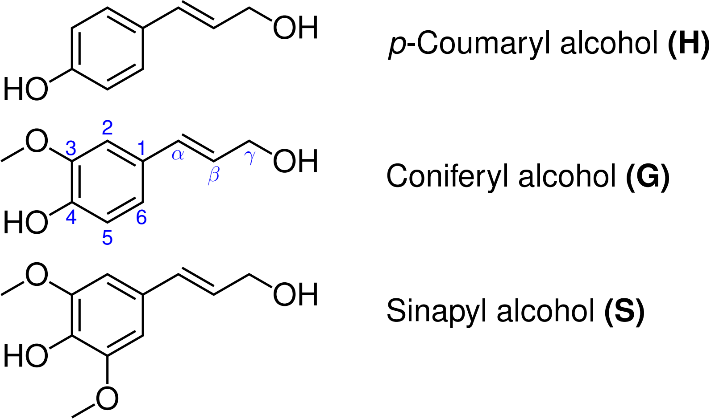

Lignin Builder
==============

.. note::

   Builders in MakroLyzer require RDKit. Activate your MakroLyzer environment and install MakroLyzer with its builder
   dependencies using ``python -m pip install ".[builder]"`` from the
   ``polymer_analysis`` directory. For more details see the :doc:`Installation details </01_Installation>`.

Lignins are complex organic polymers that form the main structural components of the supportive tissues of most plants. 
They are important in the formation of cell walls in wood, as they provide rigidity and are resistant to decay. 
Chemically, lignins are polymers formed by the cross-linking of phenolic precursors also called monolignols. 
The three **monolignols** are shown in the image below. 

These monolignols are connected via different linkers. Common linkers are:

* ``beta-O-4``
* ``phenylcoumaran-beta-5``
* ``resinol-beta-beta``
* ``5-5`` / ``4-O-beta``
* ``5-O-4``
* ``spirodienone-beta-1``
* ``4-O-beta``

.. note::

   Currently available linkers are: ``beta-O-4``, ``phenylcoumaran-beta-5``, ``resinol-beta-beta``, ``spirodienone-beta-1``, ``4-O-beta``

Linker names use the following convention:

* **First position** = incoming monolignol (usually β)
* **Second position** = existing lignin chain (usually O-4 or C5)

In MakroLyzer, the user specifies a monolignol sequence and a corresponding linker sequence.
The builder constructs the lignin strand by adding monolignols sequentially from left to right, connecting each new monolignol via the specified linker.
After each addition, the structure is optimized using the Universal Force Field (UFF) [1]_ implemented in RDKit [2]_.

Command Line Input
------------------
.. line-block::
  ``-buildLignin``
  ``--buildLigninFile``
  ``--lignin``
      Build a lignin strand from a JSON recipe specifying the monolignol and linker sequences.
      No structure or trajectory input file is required for a builder-only run.

  ``--lignin-file``
      Output XYZ filename for the constructed lignin strand.
      *Default: lignin.xyz*

  ``--builder-max-iterations``
      Maximum number of iterations per UFF minimization, including placement trials.
      Must be a positive integer.
      *Default: 1500*

Example
^^^^^^^

Create a file named ``recipe.json`` with the following contents:

.. code-block:: json

   {
     "monomer": ["G", "H", "S"],
     "linker": ["4-O-beta", "4-O-beta"]
   }

The monolignols are specified as ``H``, ``G``, or ``S``.
The linker sequence must contain exactly one fewer entry than the monolignol sequence.

Build the strand with the default settings, or specify an output filename and optimization iteration limit:

.. code-block:: bash

   MakroLyzer -buildLignin recipe.json
   MakroLyzer -buildLignin recipe.json --lignin-file myLignin.xyz --builder-max-iterations 3000

Spirodienone beta-1
^^^^^^^^^^^^^^^^^^^

``spirodienone-beta-1`` names the complete trimer in MakroLyzer: a two-unit
beta-1/alpha-O-alpha core together with its beta-O-4-linked partner [3]_.
All three monolignol-derived units are specified explicitly in the recipe.
The spirodienone step completes an existing beta-O-4 precursor by adding
one monolignol, so it must immediately follow ``beta-O-4``:

.. code-block:: json

   {
     "monomer": ["G", "G", "S"],
     "linker": ["beta-O-4", "spirodienone-beta-1"]
   }

Here the first G unit supplies O-4, the middle G unit supplies beta and its
alpha OH, and the S unit is added last. Its beta carbon bonds to the middle
unit's C1, and its alpha carbon bonds to the oxygen of the middle unit's
existing alpha OH. The middle ring becomes a dienone, losing its phenolic
hydrogen, while the alpha OH loses its hydrogen to become the cyclic ether.
The beta-O-4 connection is retained; no beta OH or additional oxygen is added.
The middle alpha--beta bond is already single, and only the incoming unit's
alpha--beta double bond is reduced.

Placement trials on both sides of the precursor ring are relaxed and compared
by UFF energy. The lower-energy initial placement is used for the subsequent
builder optimization to reduce trapping in a strained geometry.

The next addition can use a compatible free ring site on the last unit;
its beta position has been consumed. A recipe starting with
``spirodienone-beta-1`` lacks the required precursor and is rejected.

The former ``beta-1`` name and its beta-hydroxyl dimer construction have been
replaced. The conventional acyclic 1,2-diarylpropane-1,3-diol variant is not
implemented yet. These recipes provide no stereoisomer selection; the
placement and UFF relaxation produce a model geometry, without assigning
the stereochemistry occurring in native lignin.

.. [1]  Rappé, A. K.; Casewit, C. J.; Colwell, K. S.; Goddard, W. A., III; Skiff, W. M. UFF, a full periodic table force field for molecular mechanics and molecular dynamics simulations J. Am. Chem. Soc. 1992, 114, 10024-10035.
       DOI: 10.1021/ja00051a040
.. [2]  RDKit: Open-source cheminformatics. https://www.rdkit.org
       DOI: 10.5281/zenodo.591637
.. [3]  Elder, T.; Berstis, L.; Beckham, G. T.; Crowley, M. F. Density Functional
        Theory Study of Spirodienone Stereoisomers in Lignin.
        ACS Sustainable Chem. Eng. 2017, 5, 7188-7194.
        DOI: 10.1021/acssuschemeng.7b01373. Figure 1 includes a truncated third
        aryl partner; MakroLyzer retains the complete H/G/S unit templates.
