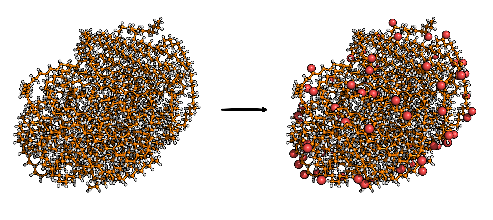

Polyethylene Surface Functionalization 
===========================================

This modifier functionalizes polyethylene (PE) surfaces by replacing selected CH2 units at
the particle surface with CO, ester, or amide groups. Surface atoms are identified using
the GITIM algorithm implemented in **pytim** [1]_ [2]_ on an **MDAnalysis** universe [3]_. A random subset of
eligible backbone carbons is chosen. End-group carbons are excluded. 

Functionalization types
-----------------------
- ``CO`` replaces CH2 with a carbonyl group. 
- ``COH`` replaces CH2 with a hydroxy group.
- ``ester`` replaces CH2-CH2 with COO.
- ``amide`` replace CH2-CH2 with CONH.

Modes
-----
- ``Random`` mode selects a target number of CH2 sites based on the requested percentage and then chooses positions at random while respecting ``neighbor_exclusion`` to keep functional groups separated. A neighbor_exclusion value of three means, that between two functional groups are at least three untouched CH2 units.

Random mode calculates each target from all carbon atoms in the outermost GITIM layer of the original structure, including
chain ends in the count. Chain ends remain unavailable for placement. The target is
rounded down to whole groups, with two backbone carbons counted for each ester or amide.

Use a comma-separated list to request multiple group types with a shared exclusion
distance, for example ``-funcPEsurf random:15:CO,10:ester:2``. Each type may
appear once and the percentages must total at most 100. Sites are reserved in input
order before any atoms are modified.

Command line
------------
.. line-block::
  ``-funcPEsurf random:percentage:func_type:neighbor_exclusion``
  ``--functionalizePEsurface``
      Random functionalization of the PE surface by replacing CH2 groups with ``func_type``.
      ``func_type`` is ``CO``, ``COH``, ``ester``, or ``amide``.
      ``percentage`` is a float from 0 to 100.
      ``neighbor_exclusion`` blocks sites up to and including that many C-C bonds away
      from any carbon assigned to another group.

  ``-funcPE-file``
  ``--functionalizePE-file``
      Output filename.
      *Default: functionalizedPE.xyz*

Example
^^^^^^^
.. code-block:: bash

   MakroLyzer -xyz PE.xyz -funcPEsurf random:15:CO:2 -funcPE-file PE_CO.xyz

.. note::

    - Chain-end carbons (with only one carbon neighbor) are excluded from functionalization.

Output
------
Each modified XYZ structure has a matching ``.info.txt`` file. For example,
``functionalizedPE_1.xyz`` is accompanied by ``functionalizedPE_1.info.txt``.
The report records the input, original atom counts, and the actual group count and
percentage for each group. Random reports also include the target and any shortfall.
The maximum count and percentage are calculated for each group as if used alone,
with the requested spacing.

.. [1]  Sega, M.; Kantorovich, S.; Jedlovszky, P.; Jorge, M. The generalized identification of truly interfacial molecules (ITIM) algorithm for nonplanar interfaces. J. Chem. Phys. 2013, 138, 044110.
       DOI: 10.1063/1.4774361
.. [2] Sega, M.; Hantal, G.; Fábián, B.; Jedlovszky, P. Pytim: A Python Package for the Interfacial Analysis of Molecular Simulations. J. Comput. Chem. 2018, 39, 2118-2125.
       DOI:  10.1002/jcc.25384
.. [3]  Michaud-Agrawal, N.; Denning, E. J.; Woolf, T. B.; Beckstein, O. MDAnalysis: A toolkit for the analysis of molecular dynamics simulations. J. Comput. Chem. 2011, 32, 2319-2327.
       DOI: 10.1002/jcc.21787
