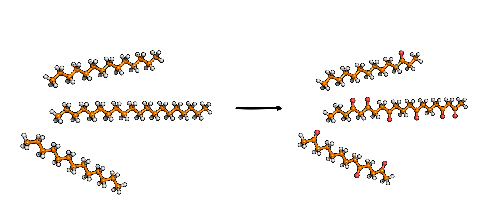
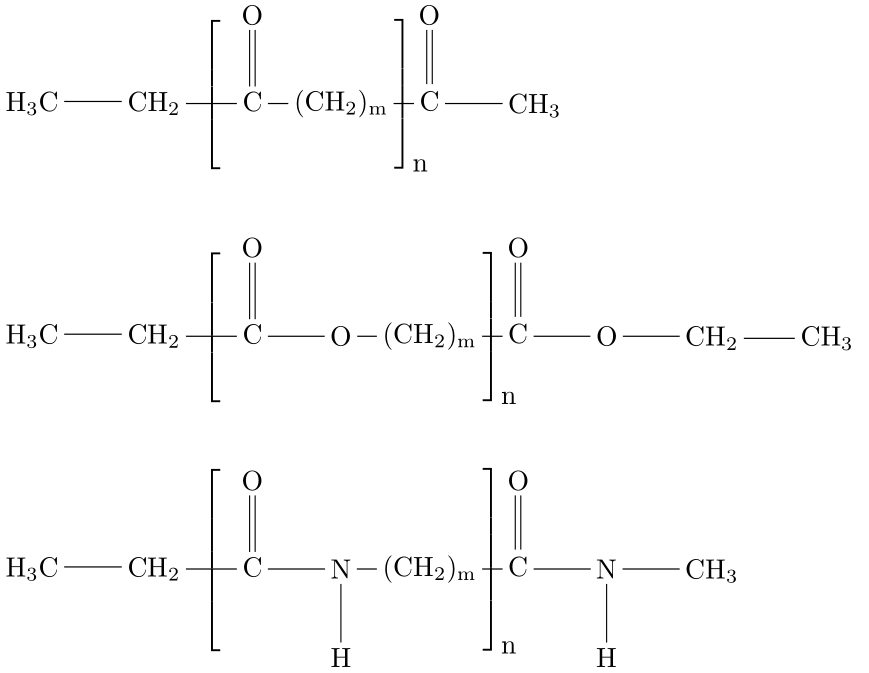

Polyethylene Functionalization 
===================================

This modifier functionalizes polyethylene (PE) by replacing selected CH2 units with
CO, ester, or amide groups. The functionalization can be random (percentage-based)
or periodic (fixed spacing along the backbone). End-group carbons are excluded.

Functionalization types
-----------------------
- ``CO`` replaces CH2 with a carbonyl group. 
- ``COH`` replaces CH2 with a hydroxy group.
- ``ester`` replaces CH2-CH2 with COO.
- ``amide`` replace CH2-CH2 with CONH.

Modes
-----
- ``Random`` mode selects a target number of CH2 sites based on the requested ``percentage`` and then chooses positions at random while respecting the ``neighbor_exclusion`` to keep functional groups separated. A neighbor_exclusion value of three means, that between two functional groups are at least three untouched CH2 units.

- ``Periodic`` mode places functional groups at a fixed interval along the backbone using the provided ``distance`` (m). A distance of three means, that between two functional groups are three untouched CH2 units. For the CO, ester and amide functionalization types, a functionalized polymer stand can look like this:

Random mode calculates each target from all carbon atoms in the original structure, including
chain ends in the count. Chain ends remain unavailable for placement. The target is
rounded down to whole groups, with two backbone carbons counted for each ester or amide.

Use a comma-separated list to request multiple group types with a shared exclusion
distance, for example ``-funcPE random:15:CO,10:ester:2``. Each type may
appear once and the percentages must total at most 100. Sites are reserved in input
order before any atoms are modified.

Command line
------------
.. line-block::
  ``-funcPE random:percentage:func_type:neighbor_exclusion``
  ``--functionalizePE``
      Random functionalization of PE by replacing CH2 groups with ``func_type``.
      ``percentage`` is a float from 0 to 100.
      ``neighbor_exclusion`` blocks sites up to and including that many C-C bonds away
      from any carbon assigned to another group.

  ``-funcPE periodic:distance:func_type``
  ``--functionalizePE``
      Periodic functionalization along the backbone.
      ``distance`` is the spacing between functional groups (integer >= 1).
      ``func_type`` is ``CO``, ``COH``, ``ester``, or ``amide``.

  ``-funcPE-file``
  ``--functionalizePE-file``
      Output filename.
      *Default: functionalizedPE.xyz*

Example
^^^^^^^
.. code-block:: bash

   MakroLyzer -xyz PE.xyz -funcPE random:15:CO:2 -funcPE-file PE_CO.xyz
   MakroLyzer -xyz PE.xyz -funcPE periodic:6:ester -funcPE-file PE_ester.xyz

.. note::

    - Chain-end carbons (with only one carbon neighbor) are excluded from functionalization.
    - For ring polyethylene, the distance criterion might not be met for two adjacent functional groups per ring. 

Output
------
Each modified XYZ structure has a matching ``.info.txt`` file. For example,
``functionalizedPE_1.xyz`` is accompanied by ``functionalizedPE_1.info.txt``.
The report records the input, original atom counts, and the actual group count and
percentage for each group. Random reports also include the target and any shortfall.
The maximum count and percentage are calculated for each group as if used alone,
with the requested spacing.
